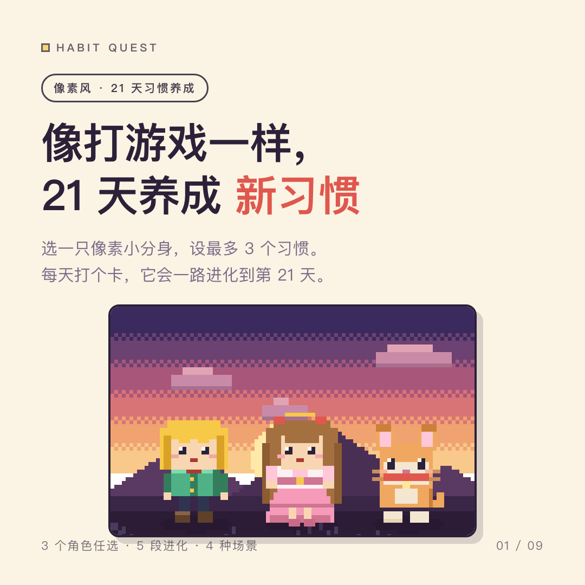

# 游戏化习惯养成 · Habit Quest

> 把 21 天习惯养成做成一款像素小游戏：养大一只你自己。

一个纯前端、单文件可部署的像素风习惯打卡应用。选一个角色，每天打卡喝水/运动/读书，看着它从幼崽一路长大，第 3 / 7 / 14 / 21 天抽卡开新场景，第 21 天拿勋章。

**在线体验**：https://habit-quest-29235.app.workbuddy.host/?sharecode=ZWBCV4MSPG



## 特性

- **3 个角色 × 5 个形态**：小王子 / 小公主 / 小猫咪，每个形态都是手写像素绘制
- **最多 3 个自定义习惯**，每个习惯配独立像素小图标
- **打卡即反馈**：经验条、血条、撒花粒子、随机夸夸文案
- **4 个进化场景**：沙漠、星空、日出、湖泊（第 3 / 7 / 14 / 21 天解锁）
- **抽卡进化**：同一场景每个角色形态不同，抽到的卡永久记录
- **随机掉落**：墨镜、头花、手杖等装饰 + 食物投喂
- **自定义奖励池**：自己写奖励（比如「打 10 分钟游戏」），打卡后从你自己的池子里掉，不会混入系统奖励
- **21 天勋章**：拿满后可继续养成，不清档
- **云存档**：登录后进度存云端，换设备接着养
- **三种登录方式**：微信扫码（推荐）/ WorkBuddy 账号 / 邮箱验证码

## 技术栈

| 层 | 说明 |
|---|---|
| 渲染 | 原生 Canvas 2D，96×64 逻辑网格像素绘制，整数倍缩放 |
| 状态 | 单个 `S` 状态对象 + `localStorage` 本地存档 |
| 云同步 | [WorkBuddy 云服务](https://www.workbuddy.cn) SDK（认证 + Postgres 行级安全） |
| 构建 | `build.py` 把模板与多个 JS 合并成单文件 `index.html`，无打包器、无依赖 |

整站是一个 180KB 的 HTML 文件，双击就能玩（不登录时走本地存档）。

## 目录结构

```
habit-quest/
├── index.html              # 构建产物：单文件应用（可直接部署）
├── template.html           # HTML 骨架 + 全部 CSS（含登录门）
├── pixel-art.js            # 像素绘制引擎：场景 / 角色 / 装饰 / 食物 / 图标
├── app.js                  # 游戏状态机、打卡、抽卡、掉落、存档
├── cloud.js                # 登录（邮箱 OTP / 微信 / WorkBuddy）与云端同步
├── build.py                # 构建脚本
├── workbuddy-cloud-sdk.js  # 云服务 SDK（本地 vendor，离线可用）
├── evolution-demo.html     # 进化演示页：3 角色 × 4 节点
├── demo.js / demo-template.html
├── promo.html              # 朋友圈宣传图生成页（1080×1080 × 9 张）
└── promo/                  # 已生成的宣传图
```

## 本地运行

```bash
# 直接打开构建产物
open index.html

# 或起个静态服务
python3 -m http.server 8080
```

改了源码后重新构建：

```bash
python3 build.py
# built index.html  178.4 KB
```

## 接自己的云服务

`cloud.js` 顶部的 `CLOUD_CFG` 里是作者自己应用的配置，**别人的 key 无法写入你的数据**，想上线自己的版本请替换：

```js
const CLOUD_CFG = {
  endpoint: 'https://<你的应用域名>',
  oauthRelayBaseUrl: 'https://www.workbuddy.cn/v2/as/genie-baas/oauth',
  publishableKey: 'wbpk_<你的 publishableKey>'
};
```

这是浏览器端的公开 key（本来就会出现在下载的 HTML 里），可以安全提交到仓库；真正的写权限由数据库行级安全策略（RLS）约束。

存档表结构：

```sql
CREATE TABLE game_states (
  id BIGINT GENERATED ALWAYS AS IDENTITY PRIMARY KEY,
  owner_id TEXT NOT NULL DEFAULT auth.uid() UNIQUE,
  state JSONB NOT NULL,
  schema_version INT NOT NULL DEFAULT 3,
  updated_at TIMESTAMPTZ NOT NULL DEFAULT now()
);
-- 开启 RLS，并只允许 owner 读写自己那一行
```

## 登录方式说明

| 方式 | 状态 | 备注 |
|---|---|---|
| 微信扫码登录 | ✅ | 走云服务 OAuth 中继，需应用侧开启微信开关 |
| WorkBuddy 账号 | ✅ | 同上，PKCE 流程 |
| 邮箱验证码 | ✅ | 无需密码，首次登录自动建号 |
| 手机短信验证码 | ⛔ 已下线 | 短信有「单手机号每日条数」上限，容易被拦；已从 UI 移除 |
| Google / GitHub | ❌ | 云服务中继不支持（GitHub 直接 400），未接入 |

## 设计取舍

- **不用打包器**：几个文件 `cat` 起来就能跑，部署就是传一个 HTML，改一行不用等编译
- **像素全部代码绘制**：没有贴图资源，角色换形态只需改绘制函数，体积小、可无级缩放
- **状态单源**：所有进度在 `S` 里，`save()` 防抖 900ms 推云端，冲突用 `owner_id` upsert 解决
- **奖励只从自己的池子里掉**：系统奖励和用户自定义奖励彻底分开，避免「我写的奖励从来没出现过」

## License

MIT
